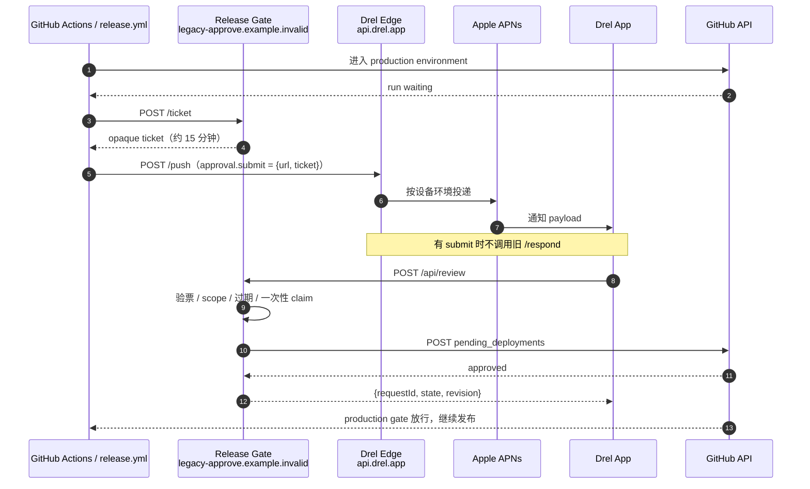

# Approval v1

Approval v1 是 WebBridgeKit 官方版与自托管版共同使用的个人审批协议。公共字段保持扁平；只有审批选项和响应方式放在 `approval` 对象中。

## 创建原生审批

```bash
curl -X POST https://api.drel.app/push \
  -H 'Content-Type: application/json' \
  -d '{
    "schema": "webbridgekit.message.v1",
    "type": "approval",
    "deviceKey": "YOUR_KEY",
    "id": "approval-42",
    "requestId": "approval-42",
    "revision": 1,
    "state": "pending",
    "title": "是否发布生产环境？",
    "body": "版本 2.4.0 已通过测试",
    "presentation": "native",
    "approval": {
      "actions": [
        {"id":"approve","title":"通过","style":"primary","resultState":"approved"},
        {"id":"reject","title":"拒绝","style":"destructive","requiresReason":true,"resultState":"rejected"}
      ],
      "responseMode": "poll"
    }
  }'
```

`device_key` 继续作为 Bark 兼容别名接受；Approval v1 文档统一使用 `deviceKey`。

## 查询状态

```bash
curl https://api.drel.app/api/v1/approvals/approval-42 \
  -H 'Authorization: Bearer YOUR_KEY'
```

查询地址由 WebBridgeKit 的 edge Durable Object 提供，源站不需要实现状态查询接口。
原生 `poll` 与 `webhook` 审批会在 APNs 接受推送后写入状态；同一条推送也进入
Tier-2 消息历史。状态记录以 `requestId` 为主键，重启 Worker 后仍可查询。

## 提交响应

iOS 客户端会按以下固定格式提交，接入方通常不需要自行调用：

```http
POST /api/v1/approvals/{requestId}/respond
Authorization: Bearer {deviceKey}
Content-Type: application/json
```

```json
{
  "actionId": "approve",
  "expectedRevision": 1,
  "values": {}
}
```

`expectedRevision` 用于防止旧页面覆盖新状态；第一份有效响应生效，后续响应返回 `409 Conflict`。需要填写理由时统一放在 `values.reason`。`values` 和路由 `params` 的值统一使用字符串，保证 curl、APNs、原生路由与 webhook 的表示一致。

`/respond` 在 edge 内以 `requestId` 对应的 Durable Object 原子提交；它只更新
审批记录，不会再次发送 APNs 推送。客户端本地把状态更新为响应结果，之后重新打开
消息时通过查询接口恢复真实状态。

### 第三方提交（`thirdParty`）

当审批由外部系统自行校验和落地，用 `responseMode: "thirdParty"` 并提供
`submit`：

```json
{
  "approval": {
    "actions": [
      {"id":"approve","title":"通过","style":"primary","resultState":"approved"},
      {"id":"reject","title":"拒绝","style":"destructive","requiresReason":true,"resultState":"rejected"}
    ],
    "responseMode": "thirdParty",
    "submit": {
      "url": "https://approve.example.com/api/review",
      "ticket": "opaque-short-lived-ticket"
    }
  }
}
```

客户端只校验 `submit.url` 是 HTTPS、host 非空且 `ticket` 非空；它不查询
Drel 的审批状态，也不自行判断 ticket 是否过期或已使用。点击动作后，客户端向
`submit.url` 原样 POST：

```json
{
  "ticket": "opaque-short-lived-ticket",
  "requestId": "approval-42",
  "actionId": "approve",
  "expectedRevision": 1,
  "values": {}
}
```

`requestId`、动作范围、过期时间、一次性重放保护、GitHub 状态校验与最终业务
操作全部由该 URL 的接收方负责。响应至少应返回客户端使用的
`{"requestId":"approval-42","state":"approved","revision":2}`。

`thirdParty` 审批不会在 Drel 官方服务里创建可查询的审批记录，因此
`GET /api/v1/approvals/{requestId}` 对它返回 `404`；状态查询由 `submit.url`
对应的系统提供。


## 时序与归属边界



`legacy-approve.example.invalid`、`dyyz1993/xbrowser`、`production` 属于当前 xbrowser
发布门禁的第三方实现，不是 Drel 官方协议的一部分。其他应用复用同一份
`approval.submit` 合同时，应提供自己的 HTTPS 审批服务和 ticket，例如
`https://approve.example.com/api/review`。Drel 官方 `api.drel.app` 仍负责消息
投递、历史和 `poll`/`webhook` 审批状态；`thirdParty` 模式不在官方侧保存
可查询状态。

## Webhook

将 `approval.responseMode` 设置为 `webhook` 并提供 HTTPS `approval.responseURL`。WebBridgeKit 使用以下请求头：

- `X-WBK-Delivery-Id`
- `X-WBK-Timestamp`
- `X-WBK-Signature: v1=<HMAC-SHA256>`

签名原文为 `timestamp + "." + rawBody`，密钥为发送审批使用的设备 Key。源站返回任意 `2xx` 表示收到，并使用 `eventId` 去重。回调地址只保存在服务端，不进入 APNs。

## 自定义页面

自定义 Web 使用顶层 `presentation: "web"` 与 `url`；受信任 PWA 使用 `presentation: "pwa"`、`appId` 与 `route`。页面及其源站自行处理查询、提交和业务状态。推送不接受原始 HTML 字符串。

## Schema

- `schemas/message-v1.schema.json`
- `schemas/approval-submission-v1.schema.json`
- `schemas/approval-response-v1.schema.json`
- `schemas/approval-status-v1.schema.json`
