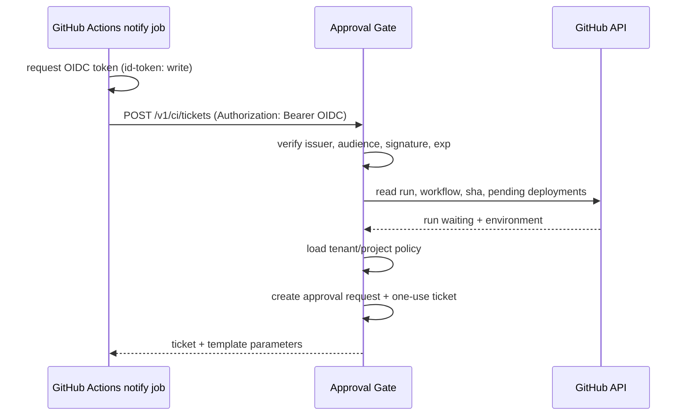

# Drel Multi-tenant Approval Gate Design

Status: Proposed  
Date: 2026-10-27  
Owner: Drel approval / release infrastructure  
Related: `docs/api/approval-v1.md`, `docs/diagrams/approval-third-party-sequence.mmd`

## 0. Decision Record

- **Proposed decision:** Evolve the current single-tenant release gate into a
  multi-tenant, provider-adaptable approval service.
- **Security baseline:** Require both a valid request ticket and a verified
  approver identity for human approval.
- **Compatibility:** Keep the current `approval.submit = {url, ticket}` shape
  while adding a request-reference/fresh-action-ticket mode.
- **First provider:** GitHub Actions protected environments.
- **Non-change:** This document does not modify code, deploy infrastructure, or
  change the current live approval route.

## 1. Executive Summary

The current `drel-release-gate` proves one important capability:

> A CI run can produce a concise approval card, Drel can render it natively,
> a short-lived ticket can protect the callback, and a trusted service can
> complete the CI approval.

It is not yet a service for all open-source projects. It is a single-tenant
reference implementation with one repository, one environment, one GitHub App,
one ticket secret, and an owner-token fallback.

The target is a multi-tenant approval service that can support many projects
and providers, while keeping Drel provider-agnostic. Drel only renders a
message and sends a decision to the URL in the message. The trusted service owns
ticket validation, approver identity, provider authorization, idempotency, and
audit.

The most important architectural rule is:

> A ticket identifies the CI request being approved. It does not identify the
> person approving it.

Therefore, a ticket alone must not authorize a human release action in the
multi-tenant version. The native Drel action must also carry a verified actor
identity, or fall back to a hosted GitHub OAuth approval step.

## 2. Goals

- Let any opted-in open-source project create an approval request.
- Let GitHub Actions prove its repository, workflow, commit, and run with
  GitHub OIDC instead of a shared CI secret.
- Support multiple projects, organizations, environments, and CI providers in
  one service without cross-tenant data or capability leakage.
- Make Drel a first-class client: a native approval card can approve and
  release through the service.
- Keep Drel free of GitHub tokens, provider credentials, and CI-specific logic.
- Make every decision attributable, replay-proof, and auditable.
- Provide a clean path to self-host the service for projects that do not want a
  public SaaS gate.

## 3. Non-goals for the first multi-tenant release

- Replace GitHub's own environment protection rules.
- Let Drel trigger an arbitrary deployment outside its configured CI.
- Support every CI provider on day one.
- Store requester or approver GitHub access tokens on the phone.
- Use a shared owner PAT as the normal approval mechanism.
- Make a public directory that automatically enrolls every repository.
- Change the `approval.submit` wire contract in a breaking way.

## 4. Threat Model and Trust Boundaries

### 4.1 Assets

- GitHub App private key and installation tokens.
- User OAuth access tokens.
- Ticket signing keys.
- CI repository, workflow, run, commit, and environment identity.
- Approver identity and group membership.
- Approval decisions and audit history.
- Drel device identity and notification delivery.

### 4.2 Trust boundaries

1. **CI to gate:** the CI request is untrusted until a GitHub OIDC token is
   verified and the run is cross-checked through the GitHub API.
2. **Gate to provider:** only the gate's provider adapter may call GitHub or
   another CI system. Drel never calls the provider directly.
3. **Gate to Drel:** a ticket is a short-lived capability for one action. The
   default decision model validates and consumes that ticket. A provider that
   needs human identity can add its own OAuth/OIDC confirmation.
4. **Tenant to tenant:** repository name alone is never a tenant key. Every
   lookup, ticket claim, cache key, rate limit, and audit event includes
   `tenant_id` and `project_id`.
5. **App installation to human reviewer:** a GitHub App installation token is
   a machine identity. It must not be treated as a human environment reviewer.

### 4.3 Primary threats

| Threat | Control |
|---|---|
| Forged CI request | GitHub OIDC signature, issuer/audience validation, run cross-check |
| Replayed approval | One-time nonce, Durable Object transaction, idempotency key |
| Ticket copied from message | Short TTL, request binding, device/user assertion, no raw ticket logs |
| Stolen device | Device key alone is insufficient for high-risk actions; require Drel account/approver identity |
| Cross-tenant access | Tenant-scoped storage keys, project policy, OIDC repository check |
| Malicious template | Schema validation, action allowlist, HTTPS-only submit URL, size limits |
| Owner PAT compromise | Remove owner PAT from the general path; use short-lived user authorization |
| App key compromise | Key rotation, least permissions, alerting, per-environment secrets |
| Provider approval spoofing | Provider API response verification, policy and reviewer checks |
| Double-click / retry | One decision per request, idempotent provider call, terminal state |

## 5. High-level Architecture



The Mermaid source is [multitenant-approval-system.mmd](../diagrams/multitenant-approval-system.mmd).

### Component responsibilities

| Component | Responsibility |
|---|---|
| Public API | Versioned CI, approval, identity, and health endpoints |
| OIDC verifier | Verify provider OIDC tokens and normalize CI identity |
| Ticket issuer/verifier | Sign short-lived, scoped, one-use request tickets |
| Optional identity broker | Provider-hosted OAuth/OIDC confirmation when explicitly required |
| Policy engine | Tenant, project, environment, ticket scope, expiry, revision, and one-time use |
| Approval state machine | `pending → authorized → executing → approved/rejected/expired/error` |
| Provider adapters | Translate a normalized decision into a provider operation |
| Audit | Immutable, queryable decision evidence with redaction |
| Admin/onboarding | Install App, register project, configure policy, test the gate |

## 6. Tenant and Project Model

Use two explicit levels:

- **Tenant:** a GitHub organization or user account that installs the service.
- **Project:** a repository and CI target within a tenant.

A tenant can contain multiple projects; a project can have multiple protected
environments. Never use `owner/repo` alone as the primary key.

```text
tenant
 ├─ installation (GitHub App installation)
 ├─ identity link (GitHub user / Drel user)
 └─ project
     ├─ provider binding (GitHub / GitLab / Jenkins / ...)
     ├─ environment binding (production / staging / ...)
     ├─ approver policy
     ├─ message template settings
     └─ approval requests
```

### Suggested tables

```text
tenants
  id, slug, name, provider, installation_id, status, created_at

projects
  id, tenant_id, provider, repository, default_branch,
  allowed_workflow_refs, status, created_at

project_environments
  id, project_id, name, provider_environment_id, protection_mode

identities
  id, tenant_id, provider, subject, github_login, drel_user_id,
  status, linked_at

approver_policies
  id, project_id, environment_id, min_approvals,
  allowed_users, allowed_teams, allowed_roles,
  self_approval_allowed, separation_of_duties, version

approval_requests
  id, tenant_id, project_id, environment_id, provider,
  run_id, run_attempt, sha, workflow_ref, state,
  ticket_jti_hash, expires_at, created_at

approval_decisions
  id, request_id, actor_identity_id, action,
  ticket_jti_hash, provider_result, decided_at

audit_events
  id, tenant_id, project_id, request_id, actor_type, actor_id,
  event_type, payload_redacted, created_at, previous_event_hash
```

The exact database choice is an implementation detail. Cloudflare D1 fits the
relational control-plane data; Durable Objects fit per-ticket and per-run
serialization; R2 can hold immutable audit exports.

## 7. GitHub OIDC

### 7.1 Workflow requirements

The ticket-request job must have:

```yaml
permissions:
  contents: read
  id-token: write
```

It requests a GitHub OIDC token with the gate audience:

```text
ACTIONS_ID_TOKEN_REQUEST_URL
ACTIONS_ID_TOKEN_REQUEST_TOKEN
audience = https://<approval-gate-host>
```

The gate must never trust `repo`, `workflow`, `runId`, `sha`, or `environment`
from the request body without cross-checking them.

### 7.2 Claims to validate

At minimum:

- `iss` is `https://token.actions.githubusercontent.com`.
- `aud` exactly matches the tenant's configured gate audience.
- `exp` and `nbf` are valid; clock skew is bounded.
- `repository` equals the configured project repository.
- `sha` equals the run's head SHA.
- `run_id` and `run_attempt` identify a real Actions run.
- `workflow_ref` matches the tenant's allowlisted workflow path, if configured.
- `ref` matches the allowed branch/tag policy.
- `actor` is recorded for audit, but is not automatically the approver.

GitHub's OIDC token may not carry the protected environment for the
`notify-pending` job because that job is not itself the protected `environment`
job. The gate must derive the pending environment by calling GitHub's Actions
API for the verified `run_id`, then bind that environment into the ticket. Do
not invent an environment claim that the provider did not issue.

### 7.3 Verification sequence



### 7.4 OIDC failure rules

- Invalid signature, wrong issuer, wrong audience, expired token: reject.
- Repository mismatch: reject before reading any project.
- Run status is not `waiting`: reject; do not mint a ticket yet.
- No pending deployment for the configured environment: reject with a bounded
  retry signal; the workflow can retry the ticket request.
- Unknown tenant, inactive project, or missing policy: fail closed.
- OIDC `actor` is not an approver. It is only a CI actor audit field.

## 8. Ticket Scope

Use a compact signed JWT/JWS. For a public multi-tenant service, prefer an
asymmetric signing key with a published JWKS and a key ID. A single global
HS256 secret is acceptable only for the current single-tenant prototype.

### 8.1 Claims

```json
{
  "iss": "https://approve.example.com",
  "aud": "approval-decision",
  "sub": "approval-request:01J...",
  "jti": "random-nonce",
  "iat": 1760000000,
  "exp": 1760000900,
  "tenantId": "ten_...",
  "projectId": "prj_...",
  "provider": "github",
  "repository": "owner/repo",
  "environment": "production",
  "runId": 40509509805,
  "runAttempt": 1,
  "sha": "b01e18e...",
  "workflowRef": "owner/repo/.github/workflows/release.yml@refs/heads/main",
  "requestId": "approval-...",
  "policyVersion": 7,
  "ticketVersion": 1
}
```

Do not put a GitHub token, private key, user email, or raw device secret in a
ticket. The ticket is visible in the Drel message and may be copied.

### 8.2 Binding rules

The ticket is accepted only if all of these match:

- Ticket signature and issuer.
- Ticket audience is the gate decision audience.
- `tenantId`, `projectId`, and `requestId` exist and are active.
- Provider is supported by the project.
- Repository, environment, run ID, run attempt, SHA, and workflow ref match the
  stored request.
- Ticket is unexpired.
- Ticket nonce is unclaimed.
- The request is still `pending`.
- The decision action is allowed by the request policy.

### 8.3 One-time and refresh semantics

- A ticket is single-use for one decision.
- Claim the nonce in a Durable Object transaction before calling the provider.
- If the provider call fails before any side effect, release the claim so the
  same ticket may retry within its TTL.
- If the provider may have accepted the decision but the connection was lost,
  query provider state by idempotency key; do not blindly re-issue a new
  decision.
- A second decision returns `409 already_decided` or
  `409 ticket_already_used`, not a generic 404.
- The approval message should offer a bounded “refresh approval” action if the
  ticket expires before the user opens the card. The refresh endpoint must
  authenticate the same CI run and create a new request or a fresh ticket for
  the existing request; it must not reuse an expired ticket.

### 8.4 Deferred evolution: request reference plus short-lived action ticket

The current `approval.submit = {url, ticket}` is convenient but embeds a
short-lived ticket in a possibly long-lived Inbox message.

This is not part of the current implementation. If inbox lifetime later proves
to be a real constraint, a future version may support:

```json
{
  "approval": {
    "responseMode": "thirdParty",
    "submit": {
      "url": "https://approve.example.com/v1/approvals/apr_123/decision",
      "mode": "requestRef",
      "requestToken": "opaque-message-reference"
    }
  }
}
```

The old shape remains accepted for compatibility. In this future shape, Drel
would exchange the request reference for a fresh short-lived decision ticket.
The approval request itself would remain stable, while credentials stay
short-lived. No device identity is required by the default contract.

## 9. Default Approval Model

The default model is a short-lived, one-time bearer ticket plus structured
JSON. Drel does not generate a device keypair, does not maintain an approval
identity, and does not send an actor assertion.

```json
{
  "ticket": "opaque-one-time-ticket",
  "requestId": "apr_123",
  "actionId": "approve",
  "expectedRevision": 1,
  "values": {}
}
```

The receiving service must:

1. Verify the ticket signature and expiration.
2. Verify that the path/body `requestId` matches the ticket.
3. Verify repository, environment, provider target, and policy version.
4. Atomically consume the ticket nonce so a second submission returns `409`.
5. Perform the provider action and record an audit event.

Possession of a valid ticket is the authorization for that one action. This is
the same capability model as a one-time deployment approval link. If a
provider requires proof of a human identity, that provider can add its own
OAuth/OIDC confirmation page or user authorization adapter; Drel's default
`approval.submit` contract stays unchanged.

Optional high-assurance identity modes may be designed later, but they must
not be required by the generic Drel client or by ordinary open-source
onboarding.

## 10. GitHub App Installation Model

### 10.1 One App, many installations

Create one public GitHub App for the approval service. Install it per
organization or user account.

- The App private key is global and stored in the service's secret manager.
- Each installation has an `installation_id`.
- The service stores installation-to-tenant mapping.
- Installation tokens are minted only for the installation and repository
  required by the current request.
- Installation tokens are cached for at most their reported lifetime, never
  written to audit logs or messages.

Required App permissions should be the minimum that supports the adapter. For
GitHub Actions:

- Actions: read/write
- Deployments: read/write
- Metadata: read
- Environments: read (and write only if the selected adapter requires it)
- Organization/team read only if the ACL needs team membership

### 10.2 App installation is not a human reviewer

The current implementation discovered a hard provider boundary: a GitHub App
installation token cannot act as a required human reviewer for a protected
environment. The implementation's owner-token fallback is a transitional
single-tenant workaround. It must not become the multi-tenant design.

Recommended split:

- **App installation token:** read run, workflow, environment, protection
  policy, pending deployment, and repository metadata.
- **User-to-server OAuth token or hosted OAuth session:** perform the actual
  human decision on `pending_deployments`.
- **Gate:** verifies that the same user is allowed by policy before using the
  user authorization.

If a project deliberately chooses a bot reviewer, mark it as
`actorType: service_account` and expose that fact in the approval UI and audit.
Do not display a bot decision as “human approved”.

### 10.3 Installation lifecycle

Handle GitHub webhooks:

- `installation.created`
- `installation.deleted`
- `installation.suspend`
- `installation.unsuspend`
- `installation_repositories.added`
- `installation_repositories.removed`

On removal or suspension, disable the tenant/project and invalidate cached
tokens. This prevents a stale installation from approving after access has
been revoked.

### 10.4 Key rotation and least privilege

- Store App private keys in Cloudflare Secrets or an external KMS.
- Rotate app keys on a schedule and immediately after suspected exposure.
- Keep separate development and production Apps.
- Never expose private keys, installation tokens, or user OAuth tokens to
  Drel, the browser, templates, or audit payloads.
- Alert on installation token failures, repeated 401/403, and unusual approval
  rates.

## 11. Provider Adapter

The gate should own a normalized decision model and provider adapters. Drel
must not know whether the target is GitHub, GitLab, Jenkins, or Argo CD.

### 11.1 Interface

```ts
interface ProviderAdapter {
  id: string;

  validateRequest(context: RequestContext): Promise<ValidatedTarget>;

  resolveProtectionPolicy(
    context: RequestContext,
    target: ValidatedTarget
  ): Promise<ProviderPolicy>;

  decide(
    context: RequestContext,
    target: ValidatedTarget,
    actor: VerifiedActor,
    decision: Decision
  ): Promise<ProviderResult>;

  status(
    context: RequestContext,
    target: ValidatedTarget
  ): Promise<ProviderStatus>;
}
```

Normalized concepts:

- `requestId`
- `tenantId`
- `projectId`
- `provider`
- `runId`
- `runAttempt`
- `targetRef` (repository or project)
- `commitSha`
- `environment`
- `workflowRef`
- `actor`
- `decision`
- `idempotencyKey`
- `policyVersion`

### 11.2 GitHub adapter

The first adapter should:

1. Read the run with an installation token.
2. Verify `status == waiting`.
3. Read the protected environment and pending deployment.
4. Resolve project and environment policy.
5. Perform the actual decision with a user authorization, or a explicitly
   flagged service-account mode.
6. Re-read provider state and return a normalized result.
7. Treat unknown provider responses as `unknown`, never as success.

The adapter must not trust the `runId` or environment supplied directly by
Drel; it uses the ticket's verified request record.

### 11.3 Future adapters

Potential adapter sequence:

1. GitHub Actions protected environments.
2. GitLab protected environments / deployment approvals.
3. Jenkins `input` / manual approval step.
4. Argo CD / Flux deployment approval.
5. Generic webhook with signed decision callback.

Each adapter documents its own identity, replay, and authorization model. A
generic webhook is not a substitute for provider-level enforcement.

## 12. APIs

### 12.1 Public / CI endpoints

```text
GET  /health
GET  /.well-known/jwks.json
POST /v1/ci/tickets
      Authorization: Bearer <GitHub OIDC token>

POST /v1/approvals/{requestId}/prepare
      device/session assertion

POST /v1/approvals/{requestId}/decision
      ticket + requestId + actionId + expectedRevision + values

GET  /v1/approvals/{requestId}
      authenticated requester or approver view
```

### 12.2 Identity endpoints

```text
GET  /v1/identities/github/start
GET  /v1/identities/github/callback
POST /v1/identities/github/unlink
```

### 12.3 Admin / onboarding

```text
POST /v1/admin/tenants
POST /v1/admin/projects
POST /v1/admin/projects/{id}/policies
POST /v1/admin/projects/{id}/test
POST /v1/webhooks/github
```

Admin endpoints should use a control-plane identity and should never share the
CI OIDC audience or a global human approval secret.

### 12.4 Response contract

```json
{
  "requestId": "apr_123",
  "state": "approved",
  "revision": 2,
  "actionId": "approve",
  "provider": "github",
  "decidedAt": "2026-10-27T14:00:00Z",
  "auditEventId": "evt_..."
}
```

Errors must be typed:

- `invalid_request`
- `unauthenticated`
- `identity_not_linked`
- `not_an_approver`
- `ticket_expired`
- `ticket_already_used`
- `request_already_decided`
- `provider_unavailable`
- `provider_rejected`
- `policy_violation`
- `audit_failed`

## 13. Drel Integration

### 13.1 What Drel keeps

- Generic message model with `type=approval`.
- Native action rendering.
- `approval.submit.url` as an opaque, HTTPS-only destination.
- An opaque one-time `ticket`.
- A structured JSON response body containing `ticket`, `requestId`,
  `actionId`, `expectedRevision`, and `values`.

Drel does not keep an approval public key, Keychain approval identity,
approver ACL, or device-signature flow in the default path.

### 13.2 What Drel must not do

- Store a GitHub App private key.
- Hold an owner PAT.
- Call GitHub directly to approve a deployment.
- Infer provider authorization from message possession.
- Put a GitHub access token in a push payload.
- Execute arbitrary provider logic from a template.

### 13.3 Native click path

1. User opens the approval message and taps the action.
2. Drel POSTs the opaque ticket and structured decision JSON to `submit.url`.
3. The receiving service verifies and atomically consumes the one-time ticket.
4. The provider adapter performs the decision.
5. The gate returns the normalized result.
6. Drel updates the card and hides terminal actions.

A provider that independently requires a human identity check can put its own
OAuth/OIDC confirmation behind `submit.url`; that is a provider-specific
policy, not an extra credential requirement in Drel.

### 13.4 Publish semantics

The gate should not publish a package itself by default. For a GitHub release,
the action approves the protected environment, and the subsequent CI jobs do
the actual publish. The provider adapter may support a controlled “publish”
workflow dispatch only if the project explicitly opts in; that is separate
from human environment approval.

This keeps the current safety boundary:

> The human approves the release gate; CI performs the release with its
> existing least-privilege workflow.

## 14. Audit and Observability

### 14.1 Audit events

Every state transition emits an event:

- tenant created / suspended
- App installation created / removed
- project configured
- policy changed
- OIDC ticket request accepted / rejected
- ticket issued
- approval request presented
- identity linked / unlinked
- approval decision received
- replay or stale ticket rejected
- provider request attempted / succeeded / failed
- request expired / cancelled
- audit export created

### 14.2 Audit fields

```json
{
  "id": "evt_...",
  "tenantId": "ten_...",
  "projectId": "prj_...",
  "requestId": "apr_...",
  "eventType": "approval.decided",
  "actorType": "human",
  "actorId": "ghu_...",
  "identityProvider": "github",
  "ticketJtiHash": "sha256:...",
  "provider": "github",
  "target": "owner/repo",
  "runId": 40509509805,
  "environment": "production",
  "sha": "b01e18e...",
  "policyVersion": 7,
  "result": "approved",
  "idempotencyKey": "idem_...",
  "createdAt": "2026-10-27T14:00:00Z",
  "previousEventHash": "sha256:..."
}
```

Rules:

- Never store raw tickets, private keys, owner PATs, or OAuth tokens.
- Store a ticket hash, not the ticket.
- Minimize personal data; use stable internal IDs and redact IP/user agents
  unless the tenant explicitly needs them.
- Use an append-only table plus export to object storage.
- Optional hash chaining makes tampering detectable; do not claim formal
  immutability unless the storage backup/retention policy supports it.
- Give tenants export access and a documented retention policy.
- Publish a public aggregate dashboard without tenant-private data.

### 14.3 Metrics and alerts

- OIDC verification failures by tenant.
- Ticket issuance and claim rates.
- Replay/expiry rates.
- Decision latency.
- Provider 4xx/5xx and rate-limit responses.
- Identity-link failures.
- Cross-tenant policy denials.
- Audit write failures (must fail closed for high-risk actions).
- App key age and rotation status.

## 15. Non-functional Requirements

These are targets for the first public rollout, not claims about the current
prototype:

| Area | Target |
|---|---|
| Availability | 99.9% for ticket and decision endpoints |
| Decision API latency | p95 under 500 ms excluding provider |
| Provider decision | bounded timeout with durable status recovery |
| Ticket TTL | 10–15 minutes |
| Audit durability | write before returning a successful high-risk decision |
| Replay protection | exactly-once claim per ticket |
| Tenant isolation | every read/write keyed by tenant and project |
| Secret exposure | zero raw tokens in logs, messages, or client storage |
| Retention | configurable, default 90 days; release evidence configurable longer |

## 16. Migration Plan

### Phase 0 — Freeze the current single-tenant implementation

- Keep the current xbrowser Worker working.
- Label it as a reference implementation, not a public service.
- Do not present `approve.xbrowser.dev` as a generic endpoint.
- Preserve the `approval.submit` compatibility path.

### Phase 1 — Tenant and project control plane

- Add tenants, projects, environments, installations, and policy records.
- Add App installation lifecycle webhooks.
- Add tenant-scoped cache keys and storage keys.
- Replace global `REPO`/`ENVIRONMENT` checks with project lookup.

### Phase 2 — GitHub OIDC ticket issuance

- Verify GitHub OIDC JWTs and JWKS.
- Cross-check run, SHA, workflow, and pending deployment through the GitHub
  API.
- Sign tenant-scoped tickets.
- Add replay and expiry tests before enabling multi-tenant issuance.

### Phase 3 — Optional provider identity and ACL

- Keep human identity confirmation provider-owned when a project requires it.
- Resolve environment reviewers, teams, roles, and self-approval policy.
- Remove the owner-PAT fallback from the normal path.

### Phase 4 — Provider adapters and audit

- Move GitHub logic behind the adapter interface.
- Add provider status recovery and idempotency.
- Add immutable audit events and tenant export.
- Add another adapter only after the first adapter has passing end-to-end gates.

### Phase 5 — Drel native approval

- Keep the generic `{url, ticket}` contract.
- Add short-lived preparation only if long-lived inbox messages make it
  necessary.
- Test native click → gate → GitHub → Drel state update on Simulator, then on
  a physical device when APNs delivery is in scope.

### Phase 6 — Public onboarding

- Publish install links and a self-service project setup flow.
- Add abuse controls, quotas, domain verification, and support tooling.
- Document a self-hosted deployment path.

## 17. Acceptance Criteria

The multi-tenant design is implementable only when these tests can pass:

1. A GitHub OIDC token for repo A cannot mint a ticket for repo B.
2. A request body claiming repo B is ignored if OIDC proves repo A.
3. A ticket for run A cannot approve run B.
4. A ticket for environment `staging` cannot approve `production`.
5. A ticket cannot be reused after one decision.
6. A valid unconsumed ticket can perform exactly one provider decision.
7. An expired or consumed ticket cannot perform a second decision.
8. If a project enables provider-owned identity confirmation, an unauthorized
   actor cannot approve through that provider adapter.
9. A GitHub App installation token cannot masquerade as a human approval.
10. Cross-tenant storage, cache, and audit reads return no data.
11. A provider timeout produces `unknown` and a retryable idempotent status,
    never a false `approved`.
12. Every successful decision has an audit event written before success is
    returned.
13. Drel receives the result and hides terminal actions; a stale click gets a
    typed terminal error.
14. A second open-source project can complete the same flow after only
    configuration and an App installation, without changing Drel.

## 18. Key Decisions (ADR Index)

| ADR | Decision | Status |
|---|---|---|
| ADR-001 | A short-lived one-time ticket authorizes exactly one decision; no Drel device identity is required by default | Accepted |
| ADR-002 | GitHub OIDC is the CI authentication mechanism; no shared CI password | Proposed |
| ADR-003 | GitHub App installation tokens are machine credentials; user OAuth performs human approval | Proposed |
| ADR-004 | Tenant + project + environment is the scope; repository alone is insufficient | Proposed |
| ADR-005 | Provider adapters implement normalized decisions; Drel stays provider-agnostic | Proposed |
| ADR-006 | Audit is append-only and written before success | Proposed |
| ADR-007 | Existing `approval.submit` remains compatible; requestRef is additive | Proposed |
| ADR-008 | Owner PAT fallback is for the current single-tenant prototype only | Proposed |

## 19. Risks and Open Questions

- GitHub's App permissions and user-token behavior for environment approval
  must be verified against the target organization, not assumed from the
  current xbrowser run.
- Drel currently has no cross-project approval identity model. Adding one is a
  product and security project, not only a Worker change.
- Public multi-tenant operation needs abuse prevention, billing/quotas, tenant
  support, and data-retention policy.
- Durable Objects are a good fit for ticket claiming; relational reporting
  should not be forced into a single DO.
- The first public release should support only GitHub Actions. Supporting every
  CI provider before the first provider is proven would increase risk without
  proving the abstraction.

## 20. Final Recommendation

Proceed with the multi-tenant direction in this order:

1. Define the tenant/project boundaries.
2. Implement GitHub OIDC and tenant-scoped tickets.
3. Move provider calls behind a GitHub adapter.
4. Add audit and only then open onboarding to additional projects.
5. Keep human identity confirmation provider-owned when a project requires it.

The existing xbrowser flow remains the compatibility harness. It should not be
the public multi-tenant security model.

## Appendix A — Provider Support Matrix

| Provider | CI identity | Approval mechanism | First release? |
|---|---|---|---|
| GitHub Actions | GitHub OIDC | Protected environment + pending deployments | Yes |
| GitLab CI | GitLab OIDC | Protected environment / deployment approval | Later |
| Jenkins | Job OIDC / signed build identity | `input` / approval step adapter | Later |
| Argo CD | Kubernetes/SSO identity | Sync window / operation approval | Later |
| Generic webhook | mTLS or signed request | Project-owned approval callback | Later |

## Appendix B — Drel Identity Linking UX

### Unlinked identity

1. User taps “approve”.
2. Drel sends the request to the gate.
3. Gate returns `identity_not_linked`.
4. Drel offers “用 GitHub 确认” and opens the hosted OAuth page.
5. Gate verifies the GitHub identity and returns to Drel.
6. Drel retries the same approval request with a fresh ticket.

### Optional provider identity confirmation

1. A project explicitly requires a provider identity check.
2. The ticket's `submit.url` points to the project's OAuth/OIDC approval page.
3. The provider-side service verifies the user and performs the decision.
4. Drel receives only the normalized terminal state.

The generic Drel client does not hold an identity private key or maintain an
approver ACL.

## Appendix C — Failure and Recovery Matrix

| Failure | User-visible result | Retry policy |
|---|---|---|
| OIDC expired | No ticket issued | CI requests a fresh token |
| Ticket expired | `ticket_expired` | Prepare a fresh action ticket |
| Ticket already used | `ticket_already_used` | Show terminal or current state |
| Actor not linked | `identity_not_linked` | Open hosted identity flow |
| Actor not in ACL | `not_an_approver` | Do not retry automatically |
| Provider 429 | `provider_unavailable` | Exponential retry with bounded window |
| Provider timeout, unknown outcome | `provider_unknown` | Query status; never auto-resend blindly |
| Provider rejects | `provider_rejected` | Show provider error and audit ID |
| Audit write failure | Fail closed for high-risk action | Retry audit or mark blocked |
| App installation revoked | Tenant disabled | Reinstall and reauthorize |
