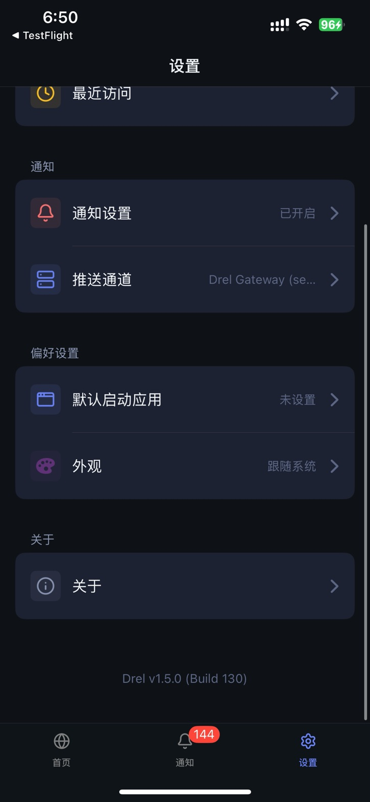
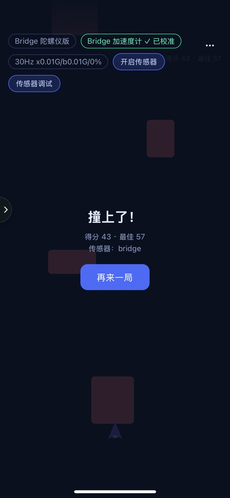

# Drel 1.5.0 build 130

Date: 2026-10-31

Build 130 makes the signed `sensors` managed action usable end-to-end, adds
simulator diagnostics and synthetic tilt to the gyro demo, and fixes return
navigation from the signed app catalog.

## Included changes

- The Drel 1.5 host allowlist now includes the signed `sensors` action, so
  Bridge calls reach `WebSensorsHandler` instead of being rejected before
  CoreMotion.
- Gyro demo v7 exposes a sensor diagnostics panel with page/app identity,
  BarkBridge availability, `callNative`/`receiveEvent`, accelerometer and
  gyroscope availability, call logs, event counts, and synthetic tilt.
- "浏览全部应用" restores the navigation bar and exposes a dedicated
  `返回我的应用` action. A web app opened from the catalog closes back to the
  catalog list; the back action returns to My Apps.
- The gyro resource manifest advances to version 7 and the signed parent
  manifest points at `bridge-gyro.v7.html`.

## Simulator verification

```text
Device:                       iPhone 13 QA, iOS 18.3.1 Simulator
GyroDebugTests:               1/1 PASS
PWAAppCatalogTests:           2/2 PASS
Combined UI assertion gate:   3/3 PASS
Drel15Release build:          BUILD SUCCEEDED
Design/repository CI lint:     PASS, 0 errors
V2 action policy:             PASS
Docs links:                   241 checked, all PASS
```

The diagnostics panel reported `accelerometer:false`, `gyroscope:false`, and
`events:0` in Simulator. The `sensors` call was not rejected by host policy,
proving dispatch reached the native layer. Synthetic right tilt advanced the
game score from 0 to 23; this validates the game loop but is not physical
sensor evidence.

## Published demo

```text
Entry:                  https://gyro.drel.app/bridge-gyro.v8.html
Entry SHA-256:          3d9f1769fcd5de493dc7d39a4d5f0213a289c25882de906b5db9840284f84a1b
Entry size:             18346 bytes
Resource manifest SHA:  621d1381a753b4dd1e8520be5f24f4ee9ad6e86ccf746cb50b355bd835014215
Signed cache version:   8
Signed action:          sensors / gyro-tilt-steer / appSession
Signing key:            gw-2026-09-15
```

Build 130 originally published v7. Physical acceptance exposed a v7 fixture
regression: the debug helper omitted the `action` field when forwarding
`startAccelerometer`, so the native status call succeeded but did not start the
stream. v8 is an online fixture hotfix only; the signed 130 app binary is
unchanged and correctly allows `sensors`.

## TestFlight publication

```text
Tag:                 v1.5.0+130
Release commit:      7cca023
GitHub Actions run:  41181799571
Result:              PASS
Archive/signing:     PASS
Upload:              PASS
processingState:     VALID
internalBuildState:  IN_BETA_TESTING
```

## Physical-device acceptance

Device: `developer的iPhone`, iPhone 13, iOS 18.7.3, wired TestFlight install.

- Settings shows `Drel v1.5.0 (Build 130)`.
- Build 130's v6 page proved the native path before the fixture hotfix:
  calibration succeeded, stream reached 31Hz, and game-over reported
  `传感器：bridge`.
- After the v8 fixture hotfix, start reported 18Hz immediately, calibrated,
  reached 30Hz, and game-over again reported `传感器：bridge`; score advanced
  to 43.
- From 浏览全部应用 → gyro detail → 打开应用, `×` returned to the catalog
  list; `返回我的应用` returned to My Apps.




