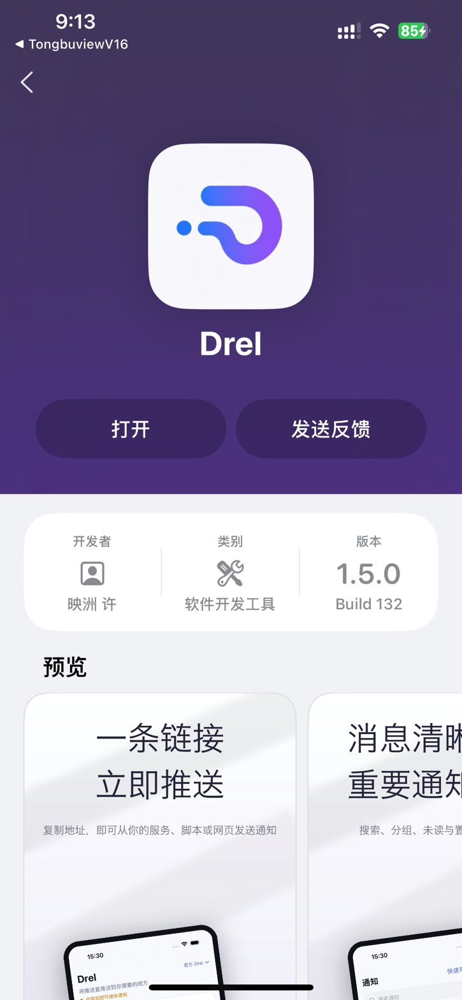
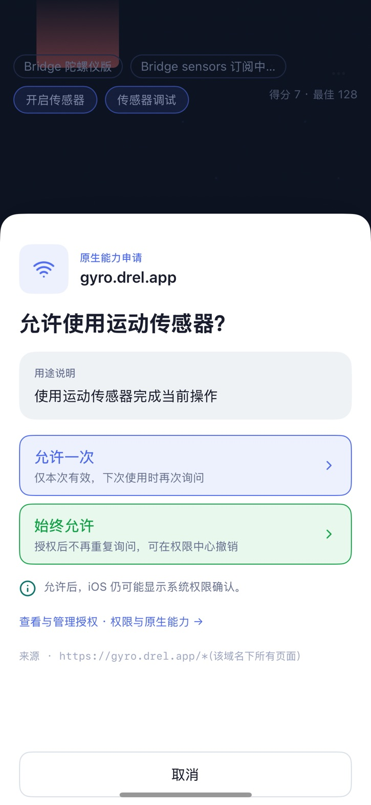
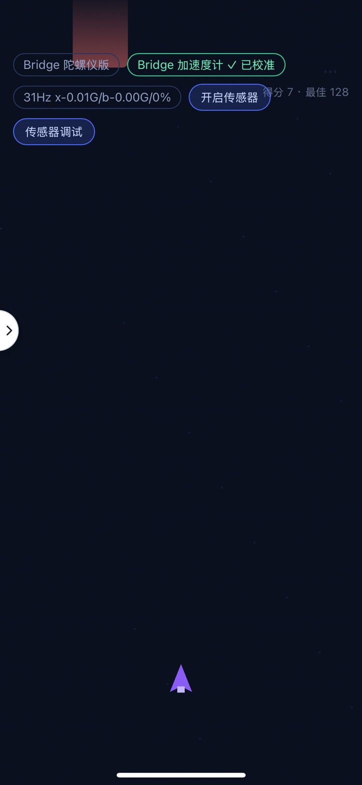
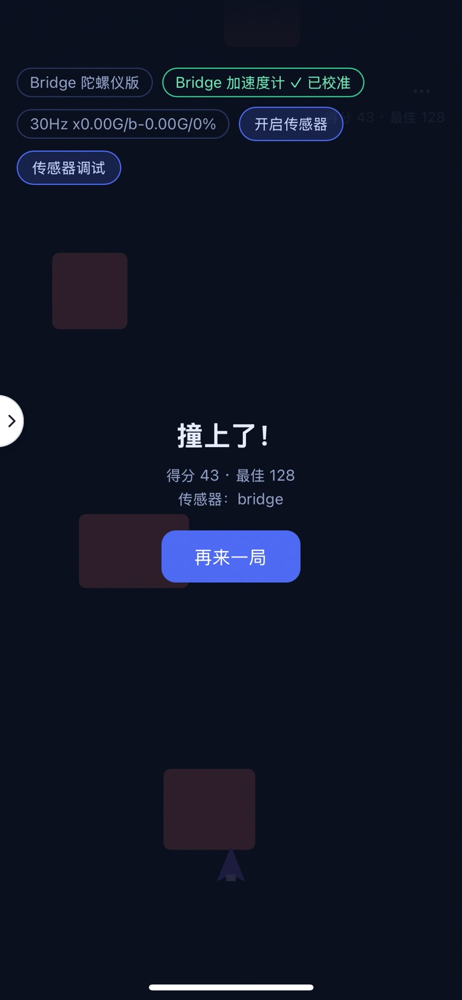
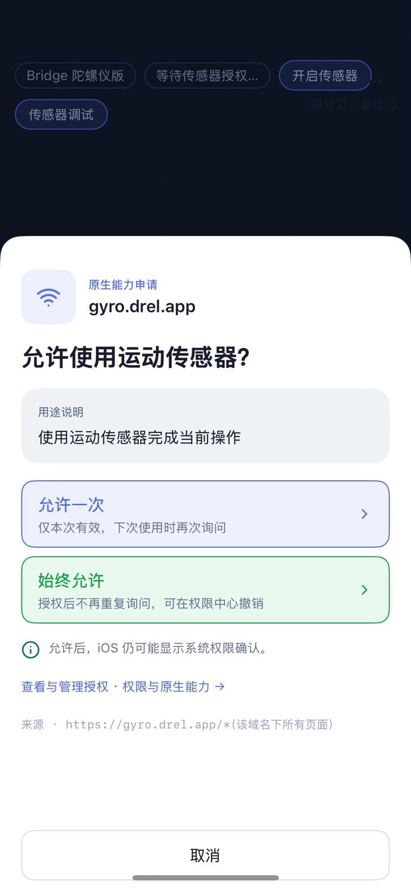
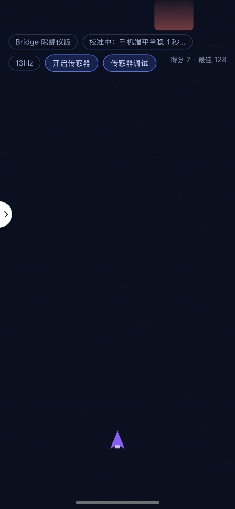

# Drel 1.5.0 build 132

Date: 2026-11-01

Build 132 closes an authorization UX/security gap found after build 131: a
grant-based V2 action could summon the consent panel without a recent user
gesture.

## Included changes

- Every V2 controlled action now consumes the foreground user-gesture gate
  before dispatch or consent.
- Grant-based actions (`sensors`, `clipboard`, `getLocation`) can no longer be
  triggered programmatically into a consent dialog.
- Non-grant V2 actions keep their existing declaration-only behavior after the
  gesture succeeds.
- WebBridgeKit framework commit: `b0aa908`
  (`fix(bridge): require gesture for grant-based actions`).

## Verification

```text
Gestureless sensors grant:      DENIED
Consent presenter requests:     0
Bridge gesture tests:           2/2 PASS
Gyro v10 UI flow:               1/1 PASS
  user click -> consent -> callback gate -> simulator fallback
Drel15Release build:            BUILD SUCCEEDED
SwiftLint:                      exit 0 (existing warnings only)
```

The framework regression specifically proves that a gestureless `sensors` call
is denied and the consent presenter request count remains zero. The UI flow
proves the normal user-click path still reaches the grant panel and callback.

## Release evidence

```text
Tag:              v1.5.0+132
Release commit:   FILLED_BY_RELEASE
Actions run:      FILLED_BY_RELEASE
ASC build state:  FILLED_BY_RELEASE
```

## Physical-device acceptance

Device: `personal-iphone`, iPhone 13, iOS 18.7.3, USB TestFlight install.

- TestFlight showed and installed `Drel 1.5.0 / Build 132`; the button changed
  from `更新` to `打开`.
- Opening the signed gyro demo and tapping Start raised the Drel motion consent
  panel only from that user click. The game remained blocked while consent was
  pending.
- Selecting `始终允许` dismissed the panel. Replaying Start again did not show
  the consent panel again.
- The key-scoped gateway manifest advanced to v10 / `always` for this phone.
- v10 Start awaited the native callback, then started only after success. The
  accelerometer calibrated at 30Hz and game-over reported `传感器：bridge`.






## Publication

```text
Tag:              v1.5.0+132
Release commit:   9aae289
Actions run:      41258708197
Workflow result:  PASS in 14m34s
Archive/upload:   PASS
ASC state:        VALID / IN_BETA_TESTING
```

## Post-acceptance hotfix: v11 stale sensor source

Physical revocation testing exposed one remaining page-level issue in v10: if
the user returned from the permission center after revocation, the page could
still remember `source=bridge` and a subsequent Start could skip the native
callback. Build 132's native gate still blocked an unauthorized call, but the
game could enter its touch fallback instead of waiting for a fresh successful
callback.

Gateway demo v11 fixes this page state machine:

- Every Start resets the local sensor state.
- Every Start issues a fresh `startAccelerometer` call and awaits its callback.
- Only a successful callback sets `source=bridge` and starts the game.
- A revoked page must therefore show consent again and cannot silently fall
  back to touch mode.

```text
v11 entry SHA-256:       09178f0d50aa9af8aae85f7358074b726ef217b3c5eedfebc99dc44a72a92a8d
v11 entry size:          19446 bytes
Web manifest SHA-256:    ba055b1b9afaae9207b03c5199bd441847727c757b71b137fe2e4f66ac2bcd4c
Signed cache version:    11
Worker asset version:    5d3bb4c6-d999-42c3-bcfa-dfc424664dad
```

Physical retest after revoking `motion=always`:

- Start showed `等待传感器授权…` and the Drel consent panel.
- Selecting `始终允许` awaited the native callback.
- The accelerometer started and calibrated; the page returned to native Bridge
  input rather than touch fallback.



