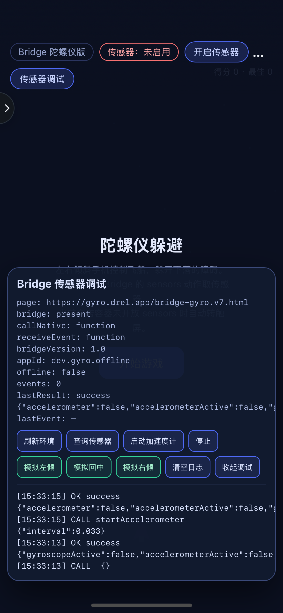
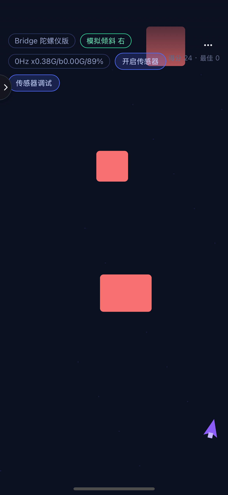
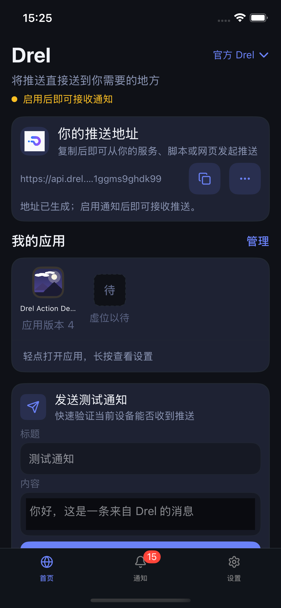

# Drel sensors 受管动作验证（陀螺仪游戏实验线）

日期：2026-10-30

## 变更

`sensors` 成为容器第 8 个受管动作（`HTMLAppControlledAction.sensors`）：
原始 CoreMotion 数据无系统隐私语义，归入展示类（`isGrantBasedAction ==
false`）——签名清单声明即可用，无授权面板、无系统弹窗。原生
`WebSensorsHandler`（加速度计/陀螺仪订阅 + `receiveEvent` 事件流）已存在，
本变更只放开白名单与能力映射。

## 验证

```text
Drel 模拟器构建:        green（策略三处穷举 switch 全通过编译）
激活门禁（gyro.offline）: 2 passed（新清单形状含 capabilities_v2
                          sensors 声明，手机端签名往返无损）
线上注册:              全局 + 私有（deviceKey 绑定）v3 均签名成功
策略单测:              testSensorsIsAControlledActionMappedToMotion
                       （WebBridgeKit-Framework/Tests/ModelsTests）
```

## 配套实验资产

- 陀螺仪躲避游戏双版本（`test_resources/gyro/`），托管 `gyro.drel.app`
  （Workers assets；workers.dev 域名在国内不可达，改用自定义域）；
- Web 版（DeviceOrientation）已在真机证明事件可达（用户实测有舵感，
  校准缺陷已修：方差门控 + 死区 + 解包裹，v3）；
- Bridge 版改为订阅协议（status → startAccelerometer(33ms) →
  receiveEvent），manifest 声明 `gyro-tilt-steer`（appSession）。

## 待真机（随下个 TestFlight 构建）

- 当前线上构建仍拒绝 `sensors`（白名单旧），HUD 显示
  「Bridge 拒绝 sensors → 触屏模式」为预期；
- 新构建上预期：开游戏 → 自动订阅 → HUD「Bridge 加速度计 ✓ 已校准」，
  无任何弹窗。

## 后续迭代（同实验线，2026-10-30）

- 首个真机数据点：DeviceOrientation 事件在 Drel 的 WKWebView 内可达
  （用户实测有单侧舵感），但校准基线缺陷导致单向锁死 → v3 修复
  （方差门控 + 死区 + 解包裹）。
- v5：Web 版改用 `accelerationIncludingGravity.x`（gamma 轴只在平持姿势
  对应左右倾斜，竖持无效——用户实测坐实）；Bridge 版订阅调用并进
  「开始游戏」手势（受管动作要求触碰后 1.5 秒内发起且手势一次性消耗）。
- 首页卡片新增离线能力双态云徽章：灰「云+下载箭头」= 支持离线未安装；
  绿实心云 = 已安装（`isOfflineCapable` / `isOfflineInstalled`）。
  Web 版应用已按用户决策下架（DeviceOrientation 路线弃用），Bridge 版
  v5 保留（离线包 v5）。

## v7 调试页、Simulator 与返回路径（2026-10-31）

### 根因

- 游戏循环和触摸兜底本身可用；Device/Simulator 的失败点是 Drel 1.5
  的 `DREL_V2_MANAGED_ACTIONS_ONLY` 白名单漏了 `sensors`，调用在进入
  `WebSensorsHandler` 前就被宿主拒绝。
- v7 调试页放在 HUD 内，但初始开始遮罩层级高于 HUD，按钮看得见却点不到。
  v7 已把 HUD 提到遮罩之上，调试入口在开始页即可操作。
- “浏览全部应用”是由隐藏了导航栏的 App Center 推入的子页面。关闭网页后
  虽然回到应用列表，但列表没有明确的返回入口。现在列表会在
  `viewWillAppear` 恢复导航栏，并提供 `pwaCatalog.back`「返回我的应用」。

### v7 调试能力

- 显示页面 URL、BarkBridge、`callNative` / `receiveEvent`、Bridge 版本、
  app ID、离线模式和事件计数。
- 可查询加速度计/陀螺仪状态、启动/停止加速度计、清空日志。
- 可注入“左倾 / 回中 / 右倾”虚拟倾斜；真实设备无传感器事件时仍能验证
  游戏循环、输入平滑和渲染，但虚拟倾斜不作为真机传感器证据。

### 线上资产

```text
entry:                  https://gyro.drel.app/bridge-gyro.v7.html
entry SHA-256:          aff9567ff3b9064d139419f7ab22f43dfc763a248c37b2a7eed4d5a8c6fe6929
entry size:             18329 bytes
resource manifest SHA:  39b54def06c2cc7330251805385b3a43fd48483fe01d67840b1b28dc063060f3
web manifest SHA:       97e646258f965555523e526a5ef0a20c248e717ebc13effe128bdf2db229b1c5
signed parent cache:    7
signed action:          sensors / gyro-tilt-steer / appSession
signing key:            gw-2026-09-15
```

### Simulator 结果

```text
device:                 Nearo iPhone 13 QA (iOS 18.3.1 Simulator)
UI tests:               3 passed, 0 failed
  GyroDebugTests:       1/1
  PWAAppCatalogTests:   2/2
Drel15Release build:    BUILD SUCCEEDED
CI/design lint:         0 errors, all checks passed
v2 action policy:       PASS
```

实测：

- `传感器调试`可打开；`查询传感器`返回成功，页面显示
  `accelerometer:false`、`gyroscope:false`，没有出现
  `Action is not enabled by host policy`；
- `启动加速度计`调用到达原生层，事件计数仍为 0；模拟器没有可用的真实
  倾斜事件流，不能替代真机校准/体感验收；
- `模拟右倾`后开始游戏，得分从 0 推进到 23，证明游戏循环正常；
- 从“浏览全部应用”打开 Web App 后，专用 `×` 回到应用列表；
  `pwaCatalog.back` 再回到“我的应用”。

### 截图






